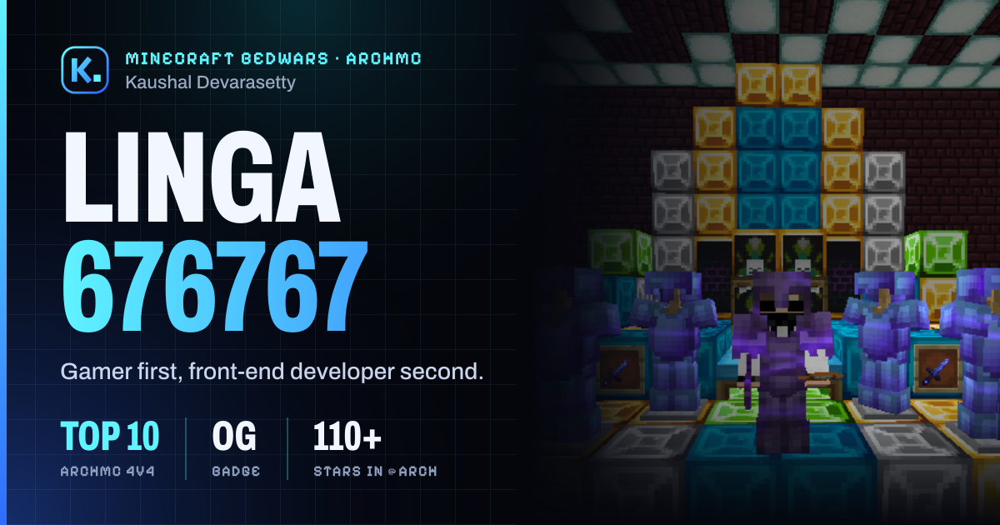

<div align="center">


# Kaushal's Portfolio Website

**A personal portfolio site for Kaushal Devarasetty (`linga676767`): Minecraft Bedwars player and early-stage front-end developer.**

Designed and built by [Ronak Chavda](https://github.com/RonakChavda-Dev) for [Kaushal Devarasetty](https://github.com/kdevarasetty7).




</div>

---

## Table of contents

- [About the project](#about-the-project)
- [Features](#features)
- [Tech stack](#tech-stack)
- [Getting started](#getting-started)
- [Editing the content](#editing-the-content)
- [Deployment](#deployment)
- [Project structure](#project-structure)
- [Credits](#credits)

## About the project

This repository holds the source for Kaushal's personal website. It is a single-page site with a dark, neon-blue gaming look. It presents Kaushal as a gamer first and a front-end developer second.

The copy on the site is written in the first person, in Kaushal's voice. Everything on it comes from his own profile: his IGN **linga676767**, his **top 10 spot on the ArchMC 4v4 Bedwars leaderboard**, his **OG** badge and **110+ Stars in @Arch**, his skills, and his links. There are no made-up projects or stats.

Kaushal's face is never shown on the site. Every picture of him is an in-game Minecraft screenshot.

## Features

- **Single page with smooth anchor navigation.** The header links scroll to About, Gaming, Bed lab, Skills and Contact, and there is a mobile menu and a scroll progress bar.
- **Hero section** with an in-game screenshot, an animated name and headline stats.
- **About section** covering Kaushal's heritage, science, badminton, chess and his floor-gaming "pro" setup, illustrated with custom voxel art.
- **Gaming section** with the ArchMC leaderboard highlight, an IGN card and a screenshot gallery with a keyboard-accessible lightbox.
- **Bed lab**, an interactive Bedwars bed-defence calculator:
  - stack up to five layers of blocks around a bed
  - see how long it takes to break through with **bare hands** or with the **best tool** for each block, for any tool tier and Efficiency level
  - see how many **TNT** it takes, or whether TNT can't get through at all (obsidian, blast-proof glass)
  - press **Blast it** to watch each TNT go off
- **Skills section** using the same labels as Kaushal's profile (Daily, Learning, Listed).
- **Contact section** with email, a Discord handle with a copy button, Twitch, GitHub, Spotify, Lichess and his Discord server.
- **Motion and accessibility.** Scroll reveals, count-ups and hover effects all respect `prefers-reduced-motion`. The markup is semantic, focus states are visible, and content stays readable if JavaScript fails.
- **SEO and link previews.** Metadata, Open Graph and Twitter cards, a generated 1200×630 preview image, `robots.txt`, `sitemap.xml`, a web manifest and `Person` JSON-LD.
- **Themed 404 page** ("Bed broken").

### How the bed lab calculates

The calculator uses vanilla Minecraft **Java Edition** formulas, so it is a guide only; servers such as ArchMC can change the mechanics.

- **Break time:** per tick, progress = tool speed ÷ block hardness ÷ 30 (÷ 100 if the block needs a tool you don't have). Efficiency adds level² + 1 to the tool speed.
- **TNT:** power 4 with an average-strength roll. The blast ray loses 0.225 every 0.3 blocks, and each block it enters costs (blast resistance + 0.3) × 0.3. A block breaks while the ray still has strength left.

The maths lives in [`src/lib/bedwars.ts`](src/lib/bedwars.ts).

## Tech stack

| Area | Choice |
| --- | --- |
| Framework | [Next.js 16](https://nextjs.org/) (App Router) |
| UI | React 19 |
| Language | TypeScript |
| Styling | Plain global CSS with design tokens (no UI library) |
| Fonts | `next/font`: Archivo for display type, Pixelify Sans for game-style labels |
| Images | `next/og` for the share image and Apple touch icon |
| Motion | CSS transitions plus Intersection Observer |
| Output | Static export (`output: "export"`) |
| Hosting | Cloudflare Pages |

## Getting started

### Prerequisites

- Node.js **20.9** or newer
- npm

### Install and run

```bash
git clone https://github.com/RonakChavda-Dev/kaushals-portfolio-website.git
cd kaushals-portfolio-website
npm install
npm run dev
```

Then open <http://localhost:3000>.

### Scripts

| Command | What it does |
| --- | --- |
| `npm run dev` | Starts the development server |
| `npm run build` | Builds the static site into `out/` |
| `npm run start` | Runs the Next.js production server |
| `npm run typecheck` | Type-checks the project with `tsc` |

## Editing the content

Every fact, link and picture on the site lives in one file: [`src/content/site.ts`](src/content/site.ts).

- Change the hero picture with `heroShot`.
- Add or remove gallery screenshots in `public/images/gameplay/` and list them in `site.ts`.
- Update the social links, skills and stats in the same file.

Some wording is copied exactly from Kaushal's existing profile (for example **OG** and **110+ Stars in @Arch**). Keep it as it is unless Kaushal confirms a change.

## Deployment

`npm run build` writes plain static files to `out/`, so the site runs on any static host. It is set up for **Cloudflare Pages**:

| Setting | Value |
| --- | --- |
| Framework preset | None (or Next.js (Static HTML Export)) |
| Build command | `npm run build` |
| Build output directory | `out` |
| Environment variables | `NEXT_PUBLIC_SITE_URL` = the live domain, plus `NODE_VERSION` = `22` if the build complains about Node |

Vercel, Netlify and GitHub Pages also work with the same build command and output folder.

### Environment variables

Copy `.env.example` and set the live domain (no trailing slash):

```bash
NEXT_PUBLIC_SITE_URL=https://your-domain.com
```

This is used for canonical links, the sitemap and link-preview images. If it isn't set, the host's own address is used (on Cloudflare, the deployment's `*.pages.dev` URL). A build with no domain at all prints a warning, because link previews would point at localhost.

### Headers and link previews

- `public/_headers` sets security and cache headers for Cloudflare Pages and Netlify: no framing, no MIME sniffing, HSTS, a strict referrer policy and long caching for built assets.
- The 1200×630 preview card is generated at build time as `/og.png` from [`src/app/og.png/route.tsx`](src/app/og.png/route.tsx). You can check it after deploying with [opengraph.xyz](https://www.opengraph.xyz/). Discord caches embeds, so changes can take a while to appear there.

## Project structure

```
src/
  app/
    layout.tsx                      fonts, metadata, SEO
    page.tsx                        the single page (all sections)
    globals.css                     theme tokens, layout and animations
    icon.svg                        the K. logo / favicon
    og.png/route.tsx                link-preview image, built to /og.png
    apple-touch-icon.png/route.tsx  home-screen icon
    not-found.tsx  manifest.ts  robots.ts  sitemap.ts
  components/
    BedDefence.tsx                  the bed lab calculator
    Gallery.tsx                     screenshot grid and lightbox
    Motion.tsx                      reveals, count-ups, tilt and spotlight effects
    SiteNav.tsx                     header, mobile menu, scroll progress
    Logo.tsx  CopyHandle.tsx
  content/site.ts                   every fact, link and picture in one place
  lib/bedwars.ts                    break-time and TNT maths
public/
  images/gameplay/                  Kaushal's in-game screenshots
  images/art/                       voxel icons (drawn by scripts/voxel-art.mjs)
  favicon.ico                       favicon fallback for browsers without SVG icons
  _headers                          security and cache headers
```

## Credits

- **Design and development:** [Ronak Chavda](https://github.com/RonakChavda-Dev)
- **Site owner and content:** Kaushal Devarasetty

### Find Kaushal

[Twitch](https://twitch.tv/linga676767) · [GitHub](https://github.com/kdevarasetty7) · [Spotify](https://open.spotify.com/user/31grbhw32dekt2z4s6gcnx4uul7y) · [Lichess](https://lichess.org/@/kaushal_D) · [Discord server](https://discord.gg/tKUA5gJXM) · Discord `@m4sterfunkyboizz` · [kaushal.hkd@gmail.com](mailto:kaushal.hkd@gmail.com)

---

<sub>The personal content, screenshots and branding on this site belong to Kaushal Devarasetty. Minecraft is a trademark of Mojang. This is a personal fan site and is not affiliated with Mojang or ArchMC.</sub>
